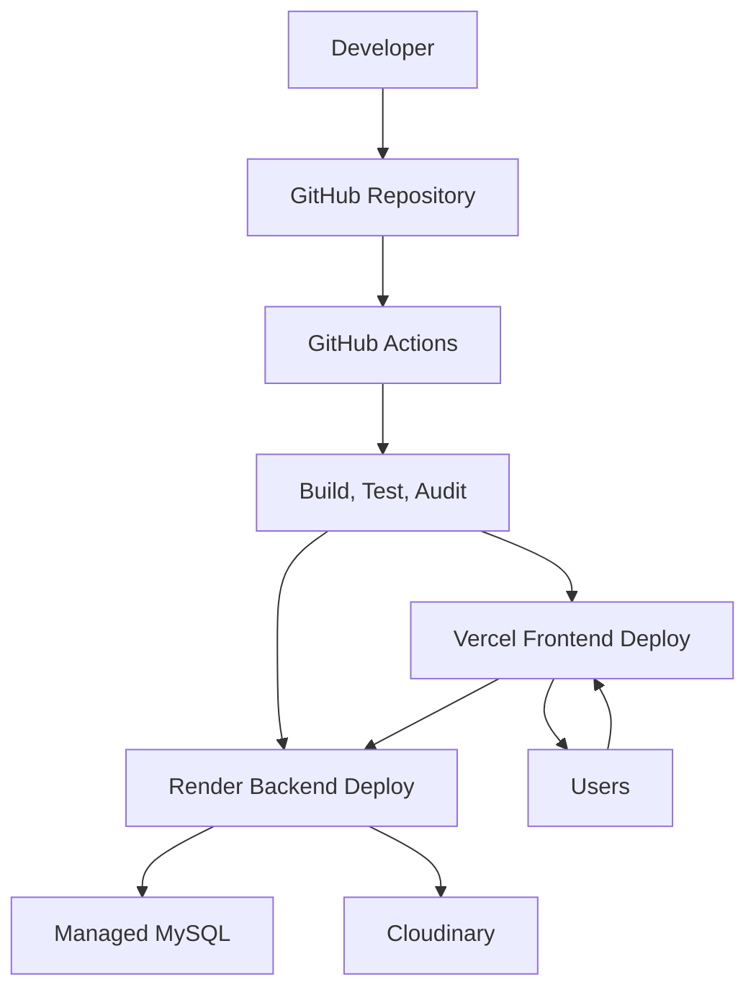

# CareerNest Module 13: Deployment and Production Readiness

## 1. Purpose of the Module

The Deployment and Production Readiness module defines how CareerNest is built, tested, secured, documented, optimized, and released to production. It covers Docker, GitHub Actions, CI/CD, Render, Vercel, Cloudinary, Swagger, README documentation, testing, performance optimization, security audit, accessibility audit, SEO, and production deployment.

This module turns CareerNest from a working application into a maintainable SaaS product that can be deployed, monitored, and improved safely.

## 2. Functional Requirements

### Docker

CareerNest should use Docker for consistent local and production-like environments.

Required containers:

- Frontend container.
- Backend container.
- MySQL container for local development.
- Optional Redis container for future caching/jobs.

Docker files:

```text
frontend/Dockerfile
backend/Dockerfile
docker-compose.yml
docker-compose.prod.yml
.dockerignore
```

Local Docker Compose should support:

- React frontend.
- Spring Boot backend.
- MySQL database.
- Environment variables.
- Health checks.
- Persistent database volume.

### GitHub Actions

CI/CD must run automated checks on pull requests and deployment branches.

Pipeline jobs:

- Frontend install.
- Frontend lint.
- Frontend build.
- Frontend tests.
- Backend compile.
- Backend tests.
- Backend package.
- Docker image build validation.
- Security dependency scan.
- Optional deploy job.

### CI/CD

Recommended branch flow:

```text
feature/* -> develop -> main
```

CI behavior:

- Pull request to `develop`: run tests/builds.
- Merge to `develop`: deploy to development/staging if configured.
- Merge to `main`: deploy to production.

Deployment must require:

- Passing tests.
- Successful build.
- Valid environment variables.
- Manual approval for production, recommended.

### Render

Recommended backend deployment target:

- Render Web Service for Spring Boot backend.
- Render managed MySQL or external managed MySQL provider.

Backend Render requirements:

- Java 21 runtime.
- Build command.
- Start command.
- Environment variables.
- Health check path.
- Production profile.

Recommended backend health endpoint:

```text
GET /api/v1/health
```

### Vercel

Recommended frontend deployment target:

- Vercel for React/Vite static deployment.

Vercel requirements:

- `VITE_API_BASE_URL`.
- Production build command.
- Output directory.
- SPA fallback/rewrite.
- Environment-specific variables.

### Cloudinary

Cloudinary must be configured backend-side for:

- Profile photos.
- Project images and screenshots.
- Certificate files.
- Resume PDFs.
- Timeline exports.

Required environment variables:

```text
CLOUDINARY_CLOUD_NAME
CLOUDINARY_API_KEY
CLOUDINARY_API_SECRET
CLOUDINARY_FOLDER
```

Rules:

- Never expose Cloudinary API secret to frontend.
- Validate file type and size before upload.
- Store public IDs for lifecycle management.
- Use folder organization by module/user where appropriate.

### Swagger

Backend must expose Swagger/OpenAPI documentation.

Recommended URLs:

```text
/swagger-ui/index.html
/v3/api-docs
```

Swagger should be:

- Enabled in local/dev/staging.
- Protected or disabled in production depending on deployment policy.
- Grouped by modules.
- Updated whenever APIs change.

### README

The project must include production-quality documentation:

```text
README.md
frontend/README.md
backend/README.md
DEPLOYMENT.md
CONTRIBUTING.md
SECURITY.md
```

README must cover:

- Product overview.
- Tech stack.
- Architecture.
- Local setup.
- Environment variables.
- Docker usage.
- Testing.
- API docs.
- Deployment.
- Folder structure.
- Contribution rules.

### Testing

Testing must be part of CI/CD.

Backend:

- Unit tests.
- Integration tests.
- Security tests.
- Repository/service/controller tests.

Frontend:

- Component tests.
- Form validation tests.
- Route protection tests.
- Build validation.

Optional later:

- E2E tests with Playwright or Cypress.
- Load tests.

### Performance Optimization

Frontend:

- Code splitting.
- Route-level lazy loading.
- Bundle analysis.
- Image optimization.
- Avoid unnecessary re-renders.
- Skeleton loading.
- API response caching where safe.

Backend:

- Pagination.
- Indexed queries.
- DTO projection for list APIs.
- Avoid N+1 queries.
- Connection pool tuning.
- Caching for expensive dashboard/admin analytics.
- Compression through proxy/platform.

### Security Audit

Security readiness must include:

- Dependency vulnerability checks.
- JWT secret strength.
- Environment secret validation.
- CORS restrictions.
- Role-based authorization review.
- File upload validation.
- Password hashing verification.
- Refresh token handling review.
- Admin privilege review.
- Sensitive logging review.

### Accessibility Audit

Frontend must meet practical accessibility expectations:

- Keyboard navigation.
- Visible focus states.
- Form labels.
- Error announcements.
- Color contrast.
- Semantic headings.
- Alt text for meaningful images.
- Accessible modals/dialogs.
- Chart summaries where needed.

### SEO

CareerNest is mostly authenticated SaaS, but public pages still need SEO:

- Landing page metadata.
- Open Graph tags.
- Favicon.
- Robots policy.
- Sitemap for public pages.
- Semantic HTML.
- Fast initial load.

Authenticated pages should generally not be indexed.

### Production Deployment

Production deployment must include:

- Frontend deployed to Vercel.
- Backend deployed to Render.
- Production MySQL database.
- Cloudinary configured.
- Environment variables configured.
- CORS frontend origin configured.
- Swagger policy configured.
- Health checks passing.
- Smoke tests passing.
- Admin user seeded securely.

## 3. Non-Functional Requirements

- Deployment must be repeatable.
- Environments must be separated.
- Secrets must never be committed.
- Production builds must be optimized.
- CI must fail on critical test/build errors.
- Production deploys must be traceable to Git commits.
- Backend must expose health checks.
- Logs must avoid sensitive data.
- Documentation must be kept current.
- Rollback strategy must exist.

## 4. Environment Architecture

### Local

Used by developers.

```text
React dev server
Spring Boot dev profile
Docker MySQL
Swagger enabled
Verbose logs
```

### Development

Shared environment for early integration.

```text
Frontend preview deployment
Backend dev deployment
Dev database
Swagger enabled
Mock/limited integrations
```

### Staging

Production-like validation environment.

```text
Production build
Staging database
Real Cloudinary test folder
Swagger protected
Production-like CORS
Smoke tests
```

### Production

Real users.

```text
Vercel frontend
Render backend
Managed MySQL
Cloudinary production folder
Strict CORS
Limited Swagger access
Error monitoring
Backups
```

## 5. Deployment Architecture



## 6. Required Configuration Files

### Root

```text
README.md
DEPLOYMENT.md
CONTRIBUTING.md
SECURITY.md
docker-compose.yml
docker-compose.prod.yml
.env.example
.gitignore
```

### GitHub Actions

```text
.github/workflows/frontend-ci.yml
.github/workflows/backend-ci.yml
.github/workflows/deploy.yml
```

### Frontend

```text
frontend/.env.example
frontend/Dockerfile
frontend/.dockerignore
frontend/vercel.json
```

### Backend

```text
backend/.env.example
backend/Dockerfile
backend/.dockerignore
backend/render.yaml
backend/src/main/resources/application.yml
backend/src/main/resources/application-dev.yml
backend/src/main/resources/application-prod.yml
```

## 7. Environment Variables

### Frontend

```text
VITE_APP_NAME=CareerNest
VITE_API_BASE_URL=https://api.careernest.example.com/api/v1
VITE_ENABLE_AI_ASSISTANT=true
VITE_ENABLE_ANALYTICS=false
```

### Backend

```text
SPRING_PROFILES_ACTIVE=prod
SERVER_PORT=8080

DB_URL=jdbc:mysql://host:3306/careernest
DB_USERNAME=careernest_user
DB_PASSWORD=secure_password

JWT_SECRET=secure_256_bit_secret
JWT_ACCESS_TOKEN_EXPIRY_MINUTES=15
JWT_REFRESH_TOKEN_EXPIRY_DAYS=30

FRONTEND_URL=https://careernest.example.com

CLOUDINARY_CLOUD_NAME=cloud_name
CLOUDINARY_API_KEY=api_key
CLOUDINARY_API_SECRET=api_secret
CLOUDINARY_FOLDER=careernest

AI_PROVIDER=mock_or_provider
AI_API_KEY=optional
AI_MODEL=optional

MAIL_FROM=no-reply@careernest.example.com
MAIL_PROVIDER_API_KEY=optional
```

## 8. CI/CD Pipeline Design

### Pull Request Pipeline

```text
Checkout
Install dependencies
Run frontend lint/test/build
Run backend tests/package
Run dependency audit
Upload test reports
Block merge on failure
```

### Main Branch Pipeline

```text
Checkout
Run full CI
Build production artifacts
Deploy frontend to Vercel
Deploy backend to Render
Run smoke tests
Notify success/failure
```

### Deployment Gates

Production deployment should require:

- Passing CI.
- No critical dependency vulnerabilities.
- Successful backend health check.
- Successful frontend availability check.
- Manual approval, recommended.

## 9. Testing Strategy

### Backend Test Gates

- Unit tests for services.
- Integration tests for controllers.
- Security tests for protected endpoints.
- Repository tests for complex queries.
- Auth flow tests.
- Admin authorization tests.

### Frontend Test Gates

- Component tests.
- Form validation tests.
- Protected route tests.
- API error state tests.
- Build success.

### Smoke Tests

Run after deployment:

```text
GET frontend URL
GET backend health endpoint
GET Swagger/API docs depending on environment
POST login with test user in staging
GET authenticated dashboard summary in staging
```

## 10. Performance Optimization Checklist

### Frontend

- Use Vite production build.
- Lazy load routes.
- Split admin and AI modules.
- Compress assets.
- Optimize images.
- Use responsive image sizes.
- Avoid unnecessary chart rendering.
- Memoize expensive UI lists.
- Paginate large lists.

### Backend

- Use pagination for all list APIs.
- Add indexes for search/filter fields.
- Use DTO projections for dashboards.
- Avoid lazy loading in response mapping.
- Enable connection pooling.
- Cache expensive analytics later.
- Use async processing for PDF/AI/export operations later.

### Database

- Index foreign keys.
- Index common filters.
- Avoid unbounded queries.
- Monitor slow queries.
- Use migrations for schema changes.

## 11. Security Audit Checklist

- No secrets in Git.
- Strong JWT secret.
- BCrypt password hashing.
- Refresh tokens hashed at rest.
- CORS restricted to frontend domain.
- HTTPS enforced by deployment platforms.
- Admin APIs protected.
- Method-level authorization on sensitive actions.
- File uploads validate type and size.
- Cloudinary secret backend-only.
- Swagger production policy defined.
- Error responses do not leak stack traces.
- Logs do not contain passwords/tokens.
- Dependency vulnerabilities reviewed.

## 12. Accessibility Audit Checklist

- All form fields have labels.
- Errors are visible and readable.
- Keyboard navigation works.
- Focus states are visible.
- Modals trap focus.
- Buttons have accessible names.
- Icons have labels or are hidden from assistive tech.
- Charts include text summaries.
- Color contrast passes practical standards.
- Layout works at mobile widths.

## 13. SEO Checklist

Public pages:

- Title tags.
- Meta descriptions.
- Open Graph metadata.
- Twitter card metadata.
- Canonical URL.
- Favicon.
- Robots.txt.
- Sitemap.xml.
- Semantic HTML.

Authenticated app:

- Prevent indexing of private routes.
- Avoid exposing private data in metadata.

## 14. Swagger Strategy

Swagger groups:

```text
Authentication
Dashboard
Projects
Resume Builder
Certifications
Internships
Learning Tracker
Coding Profiles
Career Timeline
AI Career Assistant
Admin Panel
```

Production options:

- Disable Swagger publicly in production.
- Or protect Swagger behind admin authentication/network restriction.

## 15. README Structure

Recommended root README:

```text
# CareerNest
## Overview
## Features
## Tech Stack
## Architecture
## Folder Structure
## Prerequisites
## Local Setup
## Environment Variables
## Docker Setup
## Running Tests
## API Documentation
## Deployment
## Security
## Contributing
```

## 16. Rollback Strategy

Frontend:

- Use Vercel deployment history rollback.

Backend:

- Redeploy previous Render build or Docker image.
- Keep database migrations backward-compatible where possible.

Database:

- Back up before risky migrations.
- Prefer additive migrations.
- Create rollback scripts for destructive changes.

## 17. Monitoring and Logs

Minimum production monitoring:

- Backend health endpoint.
- Render service logs.
- Vercel deployment logs.
- Database connection monitoring.
- Cloudinary upload error tracking.
- Admin monitoring dashboard.

Future:

- Sentry.
- Prometheus/Grafana.
- Centralized structured logging.
- Alerting.

## 18. Production Release Checklist

Before first production deployment:

```text
All environment variables configured
Frontend build passes
Backend build passes
Tests pass
Database migrated
Admin user seeded securely
CORS configured
Cloudinary tested
Swagger policy configured
Security audit completed
Accessibility audit completed
SEO metadata added
README and DEPLOYMENT docs completed
Smoke tests pass
Rollback plan confirmed
```

## 19. Future Scalability

The deployment architecture should support:

- Separate staging and production databases.
- Redis caching.
- Background workers.
- CDN asset optimization.
- Blue-green deployments.
- Feature flags.
- Centralized monitoring.
- Horizontal backend scaling.
- Managed secrets.
- Scheduled jobs.

## 20. Industry Best Practices

- Treat deployment as code.
- Keep secrets out of repository.
- Use `.env.example`, never real `.env`.
- Automate tests before deployment.
- Use environment-specific configuration.
- Keep production Swagger restricted.
- Use health checks.
- Use structured logs.
- Keep migrations reviewed.
- Keep README accurate.
- Prefer manual approval for production deploys.

## 21. Implementation Order After Approval

1. Create `.env.example` files.
2. Add frontend Dockerfile.
3. Add backend Dockerfile.
4. Add Docker Compose for local development.
5. Add production Docker Compose draft.
6. Add GitHub Actions frontend CI.
7. Add GitHub Actions backend CI.
8. Add deploy workflow placeholders.
9. Add Vercel configuration.
10. Add Render configuration.
11. Configure Swagger profiles.
12. Add health check endpoint.
13. Add README, DEPLOYMENT, SECURITY, and CONTRIBUTING docs.
14. Add testing scripts to CI.
15. Add performance optimization checklist tasks.
16. Add security audit checklist tasks.
17. Add accessibility audit checklist tasks.
18. Add SEO metadata strategy.
19. Run full build/test locally.
20. Prepare staging deployment.
21. Run smoke tests.
22. Prepare production deployment.

## 22. Approval Gate

No deployment implementation should begin until this architecture is approved.

After approval, implementation should begin with Docker setup, environment templates, health checks, GitHub Actions CI, and deployment documentation.
