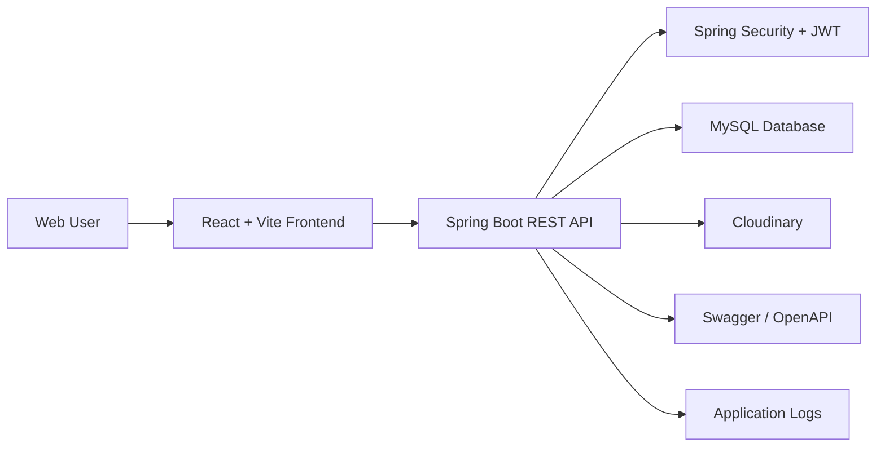
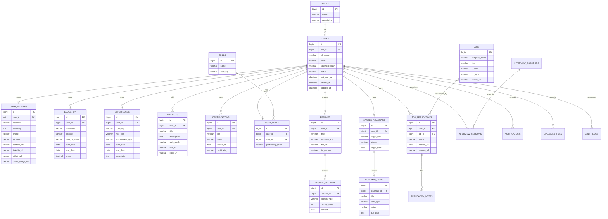
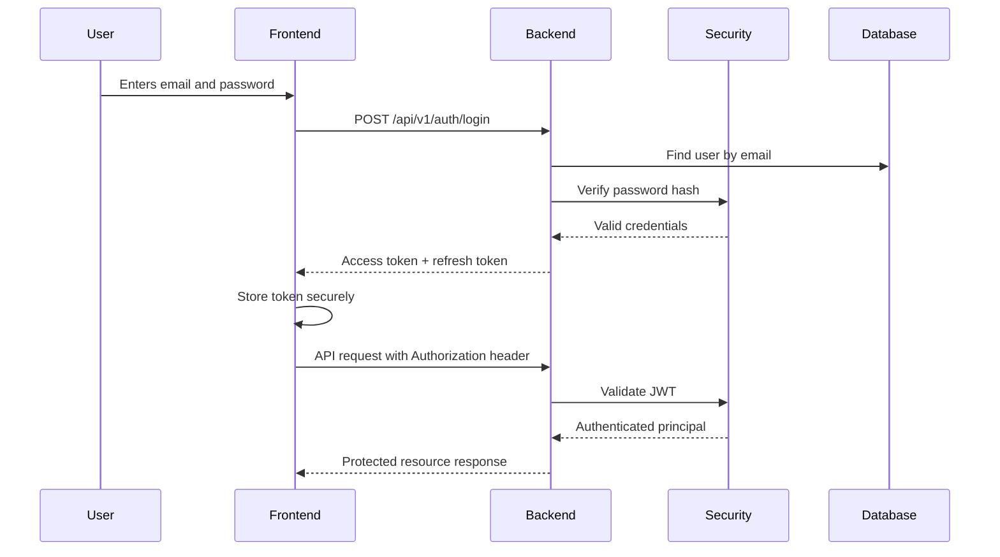
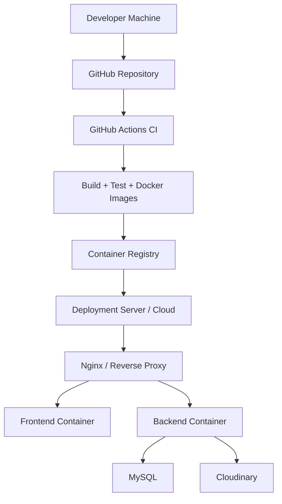

# CareerNest Module 1: Project Foundation

## 1. Product Vision

CareerNest is a production-grade SaaS platform for students and freshers to manage their complete career journey from profile building to resume creation, skill planning, job tracking, interview preparation, and progress analytics.

The platform must support real users, role-based access, secure authentication, scalable modules, maintainable code, clean UI patterns, and a deployment-ready architecture.

## 2. Architecture Principles

- Clean Architecture with clear separation between domain, application, infrastructure, and presentation concerns.
- SOLID design principles across backend services and frontend components.
- MVC pattern in Spring Boot controllers, services, repositories, DTOs, and entities.
- Feature-based frontend architecture for scalability.
- Secure-by-default backend APIs using Spring Security and JWT.
- Reusable UI components with consistent design tokens.
- DTO-based API boundaries, never exposing JPA entities directly.
- Centralized validation, exception handling, logging, and API response contracts.
- Production-oriented configuration using environment variables.
- Docker-ready service boundaries.

## 3. System Architecture

### High-Level Components



### Runtime Services

- Frontend: React SPA served through a static hosting platform or container.
- Backend: Spring Boot Java 21 REST API.
- Database: MySQL relational database.
- Media Storage: Cloudinary for profile images, resumes, certificates, and generated files.
- API Documentation: Swagger/OpenAPI.
- Deployment: Dockerized frontend, backend, and MySQL.

## 4. Frontend Architecture

### Technology

- React
- Vite
- Tailwind CSS
- Axios
- React Router
- React Hook Form
- Framer Motion
- Recharts

### Frontend Folder Structure

```text
frontend/
  src/
    app/
      App.jsx
      router.jsx
      providers/
    assets/
      images/
      icons/
    components/
      ui/
      layout/
      forms/
      charts/
      feedback/
    config/
      apiConfig.js
      routeConfig.js
      roleConfig.js
    features/
      auth/
      dashboard/
      profile/
      resumes/
      skills/
      roadmap/
      jobs/
      applications/
      interviews/
      resources/
      notifications/
      admin/
    hooks/
    lib/
      axiosClient.js
      validators.js
      formatters.js
    pages/
    services/
    store/
    styles/
      globals.css
      tokens.css
    utils/
```

### Frontend Layering

- `components/ui`: Button, Input, Select, Modal, Badge, Card, Tabs, Table, Tooltip.
- `components/layout`: Sidebar, Topbar, AuthLayout, DashboardLayout, PageHeader.
- `features`: Business modules with pages, services, hooks, forms, and local components.
- `services`: API abstraction functions.
- `lib/axiosClient.js`: Central Axios instance with auth interceptor.
- `config`: Routes, roles, menus, environment-based settings.

## 5. Backend Architecture

### Technology

- Java 21
- Spring Boot
- Spring Security
- JWT Authentication
- Hibernate
- Spring Data JPA
- MySQL
- Swagger/OpenAPI

### Backend Folder Structure

```text
backend/
  src/main/java/com/careernest/
    CareerNestApplication.java
    common/
      constants/
      dto/
      enums/
      exception/
      response/
      security/
      util/
      validation/
    config/
      SecurityConfig.java
      OpenApiConfig.java
      CorsConfig.java
      CloudinaryConfig.java
    modules/
      auth/
        controller/
        dto/
        service/
      user/
        controller/
        dto/
        entity/
        repository/
        service/
      profile/
      resume/
      skill/
      roadmap/
      job/
      application/
      interview/
      resource/
      notification/
      admin/
    infrastructure/
      cloudinary/
      email/
      logging/
  src/main/resources/
    application.yml
    application-dev.yml
    application-prod.yml
```

### Backend Layering

- Controller: Handles HTTP requests, validation trigger, response mapping.
- DTO: Request and response contracts.
- Service: Business logic and transaction boundaries.
- Repository: Database access through Spring Data JPA.
- Entity: Persistence model.
- Mapper: Converts entity to DTO and DTO to entity.
- Exception: Centralized global exception handling.
- Security: JWT filters, user details service, authorization rules.

## 6. Database Architecture

### Database

- MySQL.
- UUID or `BIGINT` identifiers. Recommended: `BIGINT AUTO_INCREMENT` for simplicity, UUID public reference fields where needed.
- Audit fields on important tables: `created_at`, `updated_at`, `created_by`, `updated_by`.
- Soft delete on user-owned career data where appropriate: `is_deleted`.
- Indexes on foreign keys, email, status fields, and date fields used for filtering.

### Core Tables

- `roles`
- `users`
- `user_profiles`
- `education`
- `experiences`
- `projects`
- `certifications`
- `skills`
- `user_skills`
- `resumes`
- `resume_sections`
- `career_roadmaps`
- `roadmap_items`
- `jobs`
- `job_applications`
- `application_notes`
- `interview_questions`
- `interview_sessions`
- `resources`
- `notifications`
- `uploaded_files`
- `audit_logs`

## 7. Complete ER Diagram



## 8. Module Design

### Auth Module

Purpose: Secure account creation, login, token refresh, logout, and password management.

Main features:
- Register student/fresher.
- Login with email and password.
- JWT access token and refresh token flow.
- Password hashing.
- Role-based access.
- Forgot/reset password extension.

### User/Profile Module

Purpose: Manage the user's professional identity.

Main features:
- Personal information.
- Education history.
- Experience history.
- Projects.
- Certifications.
- Social and portfolio links.
- Profile image upload.

### Resume Builder Module

Purpose: Let users create, preview, save, and export professional resumes.

Main features:
- Multiple resumes.
- Template selection.
- Section ordering.
- Resume PDF export.
- Primary resume marking.
- Cloudinary file storage.

### Skills Module

Purpose: Track skills, proficiency, and skill gaps.

Main features:
- Add skills by category.
- Track proficiency.
- Suggested skills by target role.
- Skill progress indicators.

### Career Roadmap Module

Purpose: Convert target roles into actionable learning and preparation plans.

Main features:
- Target role selection.
- Roadmap tasks.
- Due dates and completion tracking.
- Progress dashboard.

### Jobs Module

Purpose: Maintain job and internship opportunities.

Main features:
- Job records.
- External source links.
- Filtering by type, location, company, and role.
- Admin-created opportunities in future.

### Application Tracker Module

Purpose: Track every job application lifecycle.

Main features:
- Applied, screening, interview, offer, rejected, withdrawn statuses.
- Notes per application.
- Resume used per application.
- Follow-up reminders.

### Interview Preparation Module

Purpose: Help users practice interviews and track preparation.

Main features:
- Question bank.
- Practice sessions.
- Difficulty and category filters.
- Session history.

### Dashboard & Analytics Module

Purpose: Show useful career progress and activity.

Main features:
- Profile completion.
- Applications by status.
- Roadmap progress.
- Skill distribution.
- Resume count.
- Interview practice activity.

### Resource Module

Purpose: Store curated career resources.

Main features:
- Articles, videos, links, and templates.
- Categories.
- Admin-managed content.

### Notification Module

Purpose: Notify users about reminders and important events.

Main features:
- Application follow-ups.
- Roadmap due dates.
- System announcements.

### Admin Module

Purpose: Support platform governance and content management.

Main features:
- User management.
- Resource management.
- Job opportunity management.
- Skill taxonomy management.
- Basic platform analytics.

## 9. Navigation Design

### Public Navigation

- Home
- Features
- Pricing, future
- Login
- Register

### Authenticated Student Navigation

- Dashboard
- My Profile
- Resume Builder
- Skills
- Career Roadmap
- Jobs
- Applications
- Interview Prep
- Resources
- Notifications
- Settings

### Admin Navigation

- Admin Dashboard
- Users
- Jobs
- Skills
- Resources
- Interview Questions
- Audit Logs
- Settings

### Route Strategy

```text
/
/login
/register
/dashboard
/profile
/resumes
/skills
/roadmap
/jobs
/applications
/interviews
/resources
/notifications
/settings
/admin
/admin/users
/admin/jobs
/admin/resources
/admin/skills
```

Protected routes must validate authentication. Admin routes must additionally validate role authorization.

## 10. User Roles

### STUDENT

Primary platform user.

Permissions:
- Manage own profile.
- Manage own resumes.
- Manage own applications.
- Manage own skills and roadmap.
- View resources and jobs.
- Practice interviews.

### ADMIN

Platform administrator.

Permissions:
- Manage users.
- Manage resources.
- Manage jobs.
- Manage skill taxonomy.
- Manage interview question bank.
- View audit logs and platform metrics.

### SUPER_ADMIN

System owner.

Permissions:
- All admin permissions.
- Manage admins.
- Configure system-level settings.
- Access sensitive audit and operational data.

## 11. API Architecture

### API Base Path

```text
/api/v1
```

### API Naming Rules

- Use plural resource names.
- Use nouns, not verbs.
- Use HTTP methods for actions.
- Version all APIs.
- Use DTOs for all request and response bodies.
- Use pagination for list endpoints.
- Use standard response envelopes.

### Example API Structure

```text
POST   /api/v1/auth/register
POST   /api/v1/auth/login
POST   /api/v1/auth/refresh-token
POST   /api/v1/auth/logout

GET    /api/v1/users/me
PATCH  /api/v1/users/me

GET    /api/v1/profile
PUT    /api/v1/profile

GET    /api/v1/resumes
POST   /api/v1/resumes
GET    /api/v1/resumes/{id}
PUT    /api/v1/resumes/{id}
DELETE /api/v1/resumes/{id}

GET    /api/v1/skills
POST   /api/v1/user-skills
DELETE /api/v1/user-skills/{id}

GET    /api/v1/roadmaps
POST   /api/v1/roadmaps
PATCH  /api/v1/roadmap-items/{id}/status

GET    /api/v1/jobs
POST   /api/v1/applications
GET    /api/v1/applications
PATCH  /api/v1/applications/{id}/status

GET    /api/v1/interview-questions
POST   /api/v1/interview-sessions

GET    /api/v1/admin/users
PATCH  /api/v1/admin/users/{id}/status
```

### Standard API Response

```json
{
  "success": true,
  "message": "Request completed successfully",
  "data": {},
  "errors": null,
  "timestamp": "2026-07-17T00:00:00Z"
}
```

### Standard Error Response

```json
{
  "success": false,
  "message": "Validation failed",
  "data": null,
  "errors": [
    {
      "field": "email",
      "message": "Email is required"
    }
  ],
  "timestamp": "2026-07-17T00:00:00Z"
}
```

## 12. Authentication Flow



### Security Rules

- Passwords must be hashed with BCrypt.
- Access tokens should be short-lived.
- Refresh tokens should be revocable.
- Backend must validate role permissions on every protected route.
- Frontend route guards are only UX helpers, not security boundaries.
- CORS must allow only trusted frontend origins.
- JWT secret must come from environment variables.
- Sensitive fields must never be logged.

## 13. Reusable UI Components

### Foundation Components

- Button
- IconButton
- Input
- PasswordInput
- Textarea
- Select
- Checkbox
- RadioGroup
- Switch
- DatePicker
- FileUpload
- Modal
- Drawer
- Tabs
- Badge
- Toast
- Tooltip
- Table
- Pagination
- EmptyState
- LoadingSpinner
- ErrorState
- ConfirmDialog

### Layout Components

- AppShell
- Sidebar
- Topbar
- MobileNav
- PageHeader
- SectionHeader
- FormSection
- StatsTile
- ChartPanel

### Form Strategy

- React Hook Form for all forms.
- Shared validation helpers.
- Backend validation mirrors frontend validation.
- Field-level error display.
- Submit loading states.
- Dirty form protection where needed.

## 14. Design System

### Color Palette

CareerNest should feel professional, calm, modern, and student-friendly.

```text
Primary:        #2563EB  Blue 600
Primary Dark:   #1D4ED8  Blue 700
Accent:         #14B8A6  Teal 500
Success:        #16A34A  Green 600
Warning:        #F59E0B  Amber 500
Danger:         #DC2626  Red 600
Background:     #F8FAFC  Slate 50
Surface:        #FFFFFF  White
Surface Muted:  #F1F5F9  Slate 100
Border:         #E2E8F0  Slate 200
Text Strong:    #0F172A  Slate 900
Text Default:   #334155  Slate 700
Text Muted:     #64748B  Slate 500
```

### Typography

Recommended font:
- Inter or system font stack.

Type scale:

```text
Display: 40px / 48px / 700
H1:      32px / 40px / 700
H2:      24px / 32px / 700
H3:      20px / 28px / 600
Body:    16px / 24px / 400
Small:   14px / 20px / 400
Caption: 12px / 16px / 500
```

### Spacing

Use an 8px spacing system:

```text
4, 8, 12, 16, 24, 32, 40, 48, 64
```

### Radius

```text
Small:  4px
Medium: 8px
Large:  12px
```

Cards and panels should generally use 8px radius.

### Shadow

Use shadows lightly:

```text
sm: 0 1px 2px rgba(15, 23, 42, 0.08)
md: 0 4px 12px rgba(15, 23, 42, 0.10)
```

## 15. UI Design Direction

CareerNest is a SaaS productivity platform. The UI should prioritize clarity, scanning, and repeated use.

### Dashboard

- Left sidebar for desktop.
- Topbar with user menu and notifications.
- KPI tiles for profile completion, applications, roadmap progress, and interviews.
- Recharts for application status and skill distribution.
- Quick actions for resume creation and application tracking.

### Forms

- Use grouped sections.
- Use clear labels.
- Use inline validation.
- Avoid long single-column forms where sections can be separated.
- Save and cancel buttons should stay predictable.

### Data Lists

- Tables for admin and application tracking.
- Cards for resumes, resources, and roadmap items.
- Filters for jobs, applications, resources, and interview questions.

## 16. Responsive Strategy

### Breakpoints

```text
sm: 640px
md: 768px
lg: 1024px
xl: 1280px
2xl: 1536px
```

### Desktop

- Persistent sidebar.
- Multi-column dashboard.
- Tables with filters.
- Wider form layouts.

### Tablet

- Collapsible sidebar.
- Two-column dashboards where possible.
- Horizontal table scrolling only when necessary.

### Mobile

- Bottom or drawer navigation.
- Single-column layout.
- Cards instead of dense tables where possible.
- Touch-friendly controls with minimum 44px targets.

## 17. Naming Conventions

### Backend

```text
Entity:             User, Resume, JobApplication
Repository:         UserRepository
Service Interface:  UserService
Service Impl:       UserServiceImpl
Controller:         UserController
Request DTO:        CreateResumeRequest
Response DTO:       ResumeResponse
Mapper:             ResumeMapper
Exception:          ResourceNotFoundException
Enum:               ApplicationStatus
```

### Frontend

```text
Component:          ResumeCard.jsx
Page:               ResumeListPage.jsx
Hook:               useResumes.js
Service:            resumeService.js
Config:             routeConfig.js
Constant:           applicationStatuses.js
```

### Database

```text
Tables:             snake_case plural, example: job_applications
Columns:            snake_case, example: created_at
Foreign keys:       user_id, resume_id
Indexes:            idx_users_email
Unique constraints: uk_users_email
```

## 18. Git Branching Strategy

Recommended model: GitHub Flow with environment branches.

```text
main
develop
feature/auth-module
feature/profile-module
feature/resume-builder
feature/application-tracker
bugfix/login-token-refresh
hotfix/production-auth-issue
release/v1.0.0
```

### Rules

- `main` always represents production-ready code.
- `develop` is integration-ready code.
- Every module is built in a feature branch.
- Pull requests are required before merging.
- PRs must include tests, screenshots for UI changes, and API documentation updates where relevant.
- No direct commits to `main`.
- Use semantic commits:
  - `feat: add resume builder module`
  - `fix: correct JWT refresh validation`
  - `docs: add API architecture`
  - `refactor: simplify application service`

## 19. Deployment Architecture



### Environments

- Local: developer machine with Docker Compose.
- Development: shared internal environment.
- Staging: production-like testing environment.
- Production: real users.

### Docker Services

- `careernest-frontend`
- `careernest-backend`
- `careernest-mysql`
- Optional future: `careernest-redis`

### Environment Variables

```text
SPRING_PROFILES_ACTIVE
DB_URL
DB_USERNAME
DB_PASSWORD
JWT_SECRET
JWT_ACCESS_TOKEN_EXPIRY
JWT_REFRESH_TOKEN_EXPIRY
CLOUDINARY_CLOUD_NAME
CLOUDINARY_API_KEY
CLOUDINARY_API_SECRET
FRONTEND_URL
```

## 20. Logging, Monitoring, and Error Handling

### Backend

- Use SLF4J with structured logs.
- Log request IDs for tracing.
- Log authentication failures without exposing credentials.
- Use `@ControllerAdvice` for global exception handling.
- Use custom exceptions for business errors.
- Return consistent error response bodies.

### Frontend

- Centralized Axios error handling.
- Toasts for user-facing errors.
- Error boundaries for unexpected UI failures.
- Loading and empty states for all async views.

## 21. Validation Strategy

### Backend

- Use Jakarta Bean Validation annotations.
- Validate request DTOs with `@Valid`.
- Enforce uniqueness at database and service levels.
- Never trust frontend validation.

### Frontend

- Use React Hook Form.
- Validate required fields, formats, min/max lengths, and file limits.
- Display field-level errors.
- Disable duplicate submissions.

## 22. Security Architecture

- JWT authentication with Spring Security.
- BCrypt password hashing.
- Role-based authorization.
- CORS restricted by environment.
- DTOs to prevent over-posting.
- Input validation on all API requests.
- File upload restrictions by type and size.
- Cloudinary uploads through backend-controlled signatures or backend upload service.
- No secrets in Git.
- Rate limiting planned for auth endpoints.
- Audit logs for admin and sensitive actions.

## 23. Project Roadmap

### Phase 1: Foundation

- Architecture documentation.
- Folder structures.
- Design system.
- Database design.
- API conventions.
- Auth flow.

### Phase 2: Project Setup

- Create React Vite app.
- Configure Tailwind.
- Create Spring Boot app.
- Configure MySQL.
- Add Docker Compose.
- Add Swagger.

### Phase 3: Authentication

- Register.
- Login.
- JWT security.
- Refresh tokens.
- Role-based route protection.

### Phase 4: Student Profile

- Profile CRUD.
- Education.
- Experience.
- Projects.
- Certifications.
- Cloudinary profile image.

### Phase 5: Resume Builder

- Resume CRUD.
- Sections.
- Templates.
- PDF export.
- Primary resume.

### Phase 6: Skills and Roadmap

- Skills taxonomy.
- User skills.
- Career roadmap.
- Progress tracking.

### Phase 7: Jobs and Applications

- Job list.
- Application tracker.
- Notes.
- Status transitions.
- Follow-up reminders.

### Phase 8: Interview Preparation

- Question bank.
- Practice sessions.
- Progress history.

### Phase 9: Dashboard and Analytics

- Recharts dashboard.
- Career progress metrics.
- Application funnel.

### Phase 10: Admin and Production Readiness

- Admin dashboard.
- Content management.
- Audit logs.
- Testing.
- CI/CD.
- Deployment.

## 24. Approval Gate

Implementation should not begin until this Module 1 foundation is approved.

After approval, the next module should be:

Module 2: Project Setup

Module 2 will define exact package creation, dependency setup, frontend bootstrapping, backend bootstrapping, environment configuration, Docker Compose, and initial health-check APIs before code generation begins.
