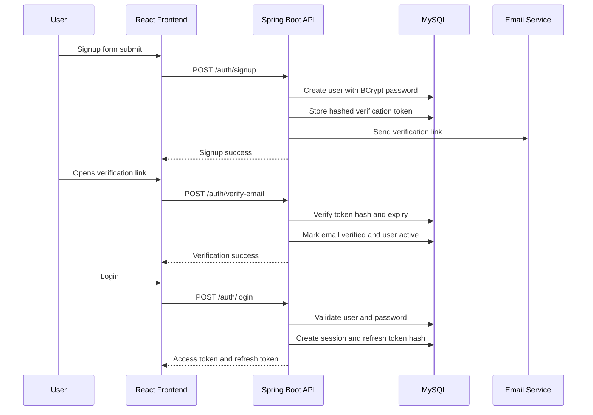

# CareerNest Module 2: Enterprise Authentication System

## 1. Purpose of the Module

The Authentication and Identity module is the security foundation of CareerNest. It handles user onboarding, login, JWT authentication, refresh tokens, email verification, password recovery, profile setup, profile photo upload, role-based authorization, and session management.

This module must be implemented as production-grade security infrastructure, not simple login/signup CRUD.

## 2. Functional Requirements

### Signup

- Register a new user with full name, email, password, and optional role invitation support.
- Default public signup role: `STUDENT`.
- Validate duplicate email addresses.
- Hash passwords before persistence.
- Create a disabled or unverified account until email verification succeeds.
- Send email verification token after successful signup.

### Login

- Authenticate using email and password.
- Reject disabled, locked, deleted, or unverified accounts according to product rules.
- Return access token, refresh token, user summary, permissions, and session metadata.
- Update last login timestamp.
- Record login session.

### JWT Authentication

- Use short-lived access tokens for API access.
- Include minimal claims: subject/user id, email, role, token type, issued-at, expiry.
- Validate JWT signature and expiry in a Spring Security filter.
- Do not store access tokens in the database.

### Refresh Token

- Generate long-lived refresh tokens.
- Store refresh tokens server-side as hashed values.
- Rotate refresh tokens on use.
- Revoke old refresh tokens after rotation.
- Support logout from current session and logout from all sessions.

### Forgot Password

- Accept email address.
- Always return a generic response to prevent email enumeration.
- Generate one-time reset token.
- Store hashed reset token with expiry.
- Send reset link by email.

### Reset Password

- Validate reset token.
- Enforce password policy.
- Hash and update new password.
- Revoke all active refresh tokens and sessions after password reset.
- Mark reset token as used.

### Email Verification

- Generate verification token during signup.
- Verify account using token.
- Support resend verification email.
- Expire verification tokens.
- Prevent already verified accounts from reusing tokens.

### Profile Setup

- Allow users to complete initial profile after verification/login.
- Capture headline, phone, location, education summary, portfolio, LinkedIn, GitHub.
- Track `profile_setup_completed`.
- Use this flag to guide frontend onboarding.

### Profile Photo

- Upload profile photo through backend-controlled Cloudinary integration.
- Validate file type and size.
- Store secure Cloudinary URL and public id.
- Allow replacing and removing profile photo.

### Role Management

- Support `STUDENT`, `ADMIN`, and `SUPER_ADMIN`.
- Public signup can only create `STUDENT`.
- Only `SUPER_ADMIN` can assign admin roles.
- Role changes must be audited.

### Session Management

- Track login sessions by device, IP, user agent, refresh token, expiry, and revoked status.
- Allow users to view active sessions.
- Allow users to revoke a session.
- Admins may force logout a user for security reasons.

## 3. Non-Functional Requirements

- Security-first design using Spring Security.
- BCrypt password hashing.
- Refresh token hashing at rest.
- Stateless access token validation.
- Server-side session visibility for refresh tokens.
- Strong validation on every request DTO.
- Consistent error response format.
- No sensitive data in logs or API responses.
- Audit logs for sensitive identity actions.
- Responsive frontend forms.
- Accessible form controls and errors.
- Swagger documentation for all APIs.
- Automated backend tests for core security flows.
- Scalable package structure that allows future MFA, OAuth, and enterprise SSO.

## 4. Database Tables

### `roles`

Stores system roles.

```text
id BIGINT PK
name VARCHAR(50) UNIQUE NOT NULL
description VARCHAR(255)
created_at DATETIME
updated_at DATETIME
```

Seed values:

```text
STUDENT
ADMIN
SUPER_ADMIN
```

### `users`

Stores account identity.

```text
id BIGINT PK
role_id BIGINT FK roles(id)
public_id VARCHAR(64) UNIQUE NOT NULL
full_name VARCHAR(120) NOT NULL
email VARCHAR(160) UNIQUE NOT NULL
password_hash VARCHAR(255) NOT NULL
account_status VARCHAR(30) NOT NULL
email_verified BOOLEAN DEFAULT FALSE
profile_setup_completed BOOLEAN DEFAULT FALSE
last_login_at DATETIME NULL
created_at DATETIME
updated_at DATETIME
deleted_at DATETIME NULL
```

Recommended `account_status` enum:

```text
PENDING_VERIFICATION
ACTIVE
LOCKED
DISABLED
DELETED
```

Indexes:

```text
uk_users_email
uk_users_public_id
idx_users_role_id
idx_users_account_status
```

### `user_profiles`

Stores profile setup data.

```text
id BIGINT PK
user_id BIGINT UNIQUE FK users(id)
headline VARCHAR(160)
phone VARCHAR(30)
location VARCHAR(120)
education_summary VARCHAR(255)
portfolio_url VARCHAR(255)
linkedin_url VARCHAR(255)
github_url VARCHAR(255)
profile_photo_url VARCHAR(500)
profile_photo_public_id VARCHAR(255)
created_at DATETIME
updated_at DATETIME
```

### `refresh_tokens`

Stores refresh token records.

```text
id BIGINT PK
user_id BIGINT FK users(id)
session_id BIGINT FK user_sessions(id)
token_hash VARCHAR(255) NOT NULL
expires_at DATETIME NOT NULL
revoked_at DATETIME NULL
replaced_by_token_id BIGINT NULL
created_at DATETIME
```

Indexes:

```text
idx_refresh_tokens_user_id
idx_refresh_tokens_session_id
idx_refresh_tokens_expires_at
```

### `user_sessions`

Tracks authenticated sessions.

```text
id BIGINT PK
user_id BIGINT FK users(id)
device_name VARCHAR(120)
ip_address VARCHAR(80)
user_agent VARCHAR(500)
login_at DATETIME
last_used_at DATETIME
expires_at DATETIME
revoked_at DATETIME NULL
revoked_reason VARCHAR(255)
created_at DATETIME
updated_at DATETIME
```

### `email_verification_tokens`

```text
id BIGINT PK
user_id BIGINT FK users(id)
token_hash VARCHAR(255) NOT NULL
expires_at DATETIME NOT NULL
verified_at DATETIME NULL
created_at DATETIME
```

### `password_reset_tokens`

```text
id BIGINT PK
user_id BIGINT FK users(id)
token_hash VARCHAR(255) NOT NULL
expires_at DATETIME NOT NULL
used_at DATETIME NULL
created_at DATETIME
```

### `audit_logs`

```text
id BIGINT PK
user_id BIGINT NULL FK users(id)
actor_user_id BIGINT NULL FK users(id)
event_type VARCHAR(80) NOT NULL
event_description VARCHAR(500)
ip_address VARCHAR(80)
user_agent VARCHAR(500)
created_at DATETIME
```

## 5. API Endpoints

Base path:

```text
/api/v1
```

### Public Auth APIs

```text
POST /api/v1/auth/signup
POST /api/v1/auth/login
POST /api/v1/auth/refresh-token
POST /api/v1/auth/forgot-password
POST /api/v1/auth/reset-password
POST /api/v1/auth/verify-email
POST /api/v1/auth/resend-verification
```

### Authenticated Auth APIs

```text
POST   /api/v1/auth/logout
POST   /api/v1/auth/logout-all
GET    /api/v1/auth/me
GET    /api/v1/auth/sessions
DELETE /api/v1/auth/sessions/{sessionId}
```

### Profile Setup APIs

```text
GET    /api/v1/profile/setup
PUT    /api/v1/profile/setup
POST   /api/v1/profile/photo
DELETE /api/v1/profile/photo
```

### Role Management APIs

```text
GET   /api/v1/admin/roles
PATCH /api/v1/admin/users/{userId}/role
PATCH /api/v1/admin/users/{userId}/status
```

## 6. API Contracts

### Signup Request

```json
{
  "fullName": "Aarav Sharma",
  "email": "aarav@example.com",
  "password": "StrongPass@123",
  "confirmPassword": "StrongPass@123"
}
```

### Login Request

```json
{
  "email": "aarav@example.com",
  "password": "StrongPass@123"
}
```

### Login Response

```json
{
  "success": true,
  "message": "Login successful",
  "data": {
    "accessToken": "jwt-access-token",
    "refreshToken": "opaque-refresh-token",
    "tokenType": "Bearer",
    "expiresIn": 900,
    "user": {
      "id": "usr_01HZX",
      "fullName": "Aarav Sharma",
      "email": "aarav@example.com",
      "role": "STUDENT",
      "emailVerified": true,
      "profileSetupCompleted": false
    }
  },
  "errors": null,
  "timestamp": "2026-07-17T00:00:00Z"
}
```

### Forgot Password Request

```json
{
  "email": "aarav@example.com"
}
```

### Reset Password Request

```json
{
  "token": "reset-token",
  "newPassword": "NewStrongPass@123",
  "confirmPassword": "NewStrongPass@123"
}
```

### Profile Setup Request

```json
{
  "headline": "Aspiring Full Stack Developer",
  "phone": "+91 9876543210",
  "location": "Bengaluru, India",
  "educationSummary": "B.Tech Computer Science",
  "portfolioUrl": "https://portfolio.example.com",
  "linkedinUrl": "https://linkedin.com/in/aarav",
  "githubUrl": "https://github.com/aarav"
}
```

## 7. Backend Folder Structure

```text
backend/
  src/main/java/com/careernest/
    common/
      dto/
        ApiResponse.java
        FieldErrorResponse.java
      exception/
        GlobalExceptionHandler.java
        BadRequestException.java
        ResourceNotFoundException.java
        UnauthorizedException.java
        ForbiddenException.java
      security/
        JwtAuthenticationFilter.java
        JwtTokenProvider.java
        CustomUserDetails.java
        CustomUserDetailsService.java
      util/
        TokenGenerator.java
        HashingUtil.java
    config/
      SecurityConfig.java
      CorsConfig.java
      OpenApiConfig.java
      CloudinaryConfig.java
    modules/
      auth/
        controller/
          AuthController.java
        dto/
          SignupRequest.java
          LoginRequest.java
          TokenRefreshRequest.java
          ForgotPasswordRequest.java
          ResetPasswordRequest.java
          VerifyEmailRequest.java
          AuthResponse.java
        entity/
          RefreshToken.java
          EmailVerificationToken.java
          PasswordResetToken.java
          UserSession.java
        repository/
          RefreshTokenRepository.java
          EmailVerificationTokenRepository.java
          PasswordResetTokenRepository.java
          UserSessionRepository.java
        service/
          AuthService.java
          AuthServiceImpl.java
          RefreshTokenService.java
          PasswordResetService.java
          EmailVerificationService.java
          SessionService.java
      user/
        controller/
          UserController.java
          AdminUserController.java
        dto/
          UserResponse.java
          UpdateUserRoleRequest.java
          UpdateUserStatusRequest.java
        entity/
          User.java
          Role.java
        repository/
          UserRepository.java
          RoleRepository.java
        service/
          UserService.java
          RoleService.java
      profile/
        controller/
          ProfileSetupController.java
        dto/
          ProfileSetupRequest.java
          ProfileSetupResponse.java
        entity/
          UserProfile.java
        repository/
          UserProfileRepository.java
        service/
          ProfileSetupService.java
          ProfilePhotoService.java
      audit/
        entity/
          AuditLog.java
        repository/
          AuditLogRepository.java
        service/
          AuditLogService.java
```

## 8. Frontend Folder Structure

```text
frontend/
  src/
    app/
      router.jsx
      providers/
        AuthProvider.jsx
    components/
      ui/
        Button.jsx
        Input.jsx
        PasswordInput.jsx
        Alert.jsx
        Toast.jsx
        FileUpload.jsx
      layout/
        AuthLayout.jsx
        DashboardLayout.jsx
        ProtectedRoute.jsx
        RoleGuard.jsx
    features/
      auth/
        pages/
          SignupPage.jsx
          LoginPage.jsx
          ForgotPasswordPage.jsx
          ResetPasswordPage.jsx
          VerifyEmailPage.jsx
        components/
          SignupForm.jsx
          LoginForm.jsx
          ForgotPasswordForm.jsx
          ResetPasswordForm.jsx
        services/
          authService.js
        hooks/
          useAuth.js
        validation/
          authSchemas.js
      onboarding/
        pages/
          ProfileSetupPage.jsx
        components/
          ProfileSetupForm.jsx
          ProfilePhotoUpload.jsx
      sessions/
        pages/
          SessionsPage.jsx
        components/
          SessionList.jsx
      admin/
        users/
          UserRoleManagementPage.jsx
    lib/
      axiosClient.js
      tokenStorage.js
    config/
      routeConfig.js
      roleConfig.js
```

## 9. UI Design

### Auth Pages

- Split-screen desktop layout:
  - Left: CareerNest brand, value proposition, subtle product preview.
  - Right: focused form panel.
- Mobile layout:
  - Single-column form.
  - Brand header at top.
  - Touch-friendly fields and buttons.

### Forms

- Signup form:
  - Full name
  - Email
  - Password
  - Confirm password
  - Submit button
  - Login link

- Login form:
  - Email
  - Password
  - Forgot password link
  - Submit button
  - Signup link

- Forgot password:
  - Email
  - Generic success state

- Reset password:
  - New password
  - Confirm password
  - Password strength helper

- Email verification:
  - Token verification state
  - Resend verification action

- Profile setup:
  - Profile photo upload
  - Headline
  - Phone
  - Location
  - Education summary
  - Portfolio links

### Responsive Strategy

- `sm`: single-column forms.
- `md`: centered auth card.
- `lg`: split layout.
- Use minimum 44px control height.
- Avoid table-heavy session UI on mobile; use session cards instead.

## 10. Security Considerations

- Store passwords using BCrypt only.
- Store refresh, reset, and verification tokens as hashes.
- Use cryptographically secure random opaque refresh/reset/verification tokens.
- Access token expiry: recommended 15 minutes.
- Refresh token expiry: recommended 7 to 30 days depending on remember-me policy.
- Rotate refresh tokens on every refresh.
- Revoke all sessions after password reset.
- Use generic forgot-password responses.
- Do not leak whether email exists.
- Rate limit login, forgot-password, and resend-verification endpoints in future.
- Validate file uploads by MIME type, extension, and size.
- Only allow image uploads for profile photo.
- Never log passwords, raw tokens, JWTs, or reset links.
- Use role checks on backend methods, not only controller paths.
- Admin role changes require `SUPER_ADMIN`.
- CORS must be environment-specific.
- Cookies vs local storage decision:
  - Recommended production approach: refresh token in HttpOnly Secure SameSite cookie.
  - Access token can be kept in memory on frontend.
  - Simpler development approach may return both tokens in response, but production should prefer cookie refresh tokens.

## 11. Authentication Flow



## 12. Future Scalability

This module should be designed to support:

- Multi-factor authentication.
- OAuth login with Google and GitHub.
- Enterprise SSO.
- Device trust management.
- Login anomaly detection.
- Account lockout policy.
- Organization/team accounts.
- Admin impersonation with audit controls.
- Email provider abstraction.
- Redis-backed token/session blacklist if needed.

## 13. Industry Best Practices

- Keep auth logic out of controllers.
- Use DTOs for every request and response.
- Use transaction boundaries in service methods.
- Use `@ControllerAdvice` for global exceptions.
- Use `@PreAuthorize` for method-level authorization.
- Use integration tests for security endpoints.
- Seed roles through migration or startup initializer.
- Document all APIs in Swagger.
- Keep auth configuration environment-driven.
- Audit sensitive actions.
- Separate user identity from profile data.
- Avoid exposing sequential internal IDs to frontend where possible; use `public_id`.

## 14. Testing Strategy

### Backend Unit Tests

- Signup validation.
- Duplicate email handling.
- Password hashing.
- Login credential validation.
- Refresh token rotation.
- Reset token expiry.
- Email verification token expiry.
- Role authorization rules.

### Backend Integration Tests

- Signup to email verification flow.
- Login to authenticated endpoint flow.
- Refresh token flow.
- Forgot/reset password flow.
- Logout current session.
- Logout all sessions.
- Admin role change authorization.

### Frontend Tests

- Form validation.
- Error rendering.
- Loading states.
- Protected route behavior.
- Role-based route access.
- Token refresh handling.

### Security Tests

- Expired JWT rejected.
- Tampered JWT rejected.
- Unverified account login rejected.
- Revoked refresh token rejected.
- Used password reset token rejected.
- Non-admin cannot access admin APIs.

## 15. Swagger Documentation

Swagger groups:

```text
Authentication
Profile Setup
Session Management
Role Management
```

Each endpoint must document:

- Summary.
- Description.
- Request body schema.
- Response schema.
- Validation errors.
- Security requirement if protected.
- Status codes.

Recommended status codes:

```text
200 OK
201 Created
400 Bad Request
401 Unauthorized
403 Forbidden
404 Not Found
409 Conflict
422 Unprocessable Entity
429 Too Many Requests, future
500 Internal Server Error
```

## 16. Deployment and Configuration

Required backend environment variables:

```text
JWT_SECRET
JWT_ACCESS_TOKEN_EXPIRY_MINUTES
JWT_REFRESH_TOKEN_EXPIRY_DAYS
FRONTEND_URL
MAIL_FROM
MAIL_PROVIDER_API_KEY
CLOUDINARY_CLOUD_NAME
CLOUDINARY_API_KEY
CLOUDINARY_API_SECRET
```

Required frontend environment variables:

```text
VITE_API_BASE_URL
VITE_APP_NAME
```

## 17. Implementation Order After Approval

1. Backend dependencies and security configuration.
2. User, role, profile, token, session, and audit entities.
3. Repositories.
4. DTOs and validation.
5. JWT provider and security filter.
6. Auth services.
7. Profile setup and profile photo services.
8. Controllers.
9. Swagger configuration.
10. Backend tests.
11. Axios client and auth provider.
12. Auth pages and forms.
13. Protected routes and role guards.
14. Session management UI.
15. Responsive polish and frontend validation.

## 18. Approval Gate

No implementation should begin until this authentication architecture is approved.

After approval, implementation can begin with the backend authentication foundation first, followed by frontend forms and protected routing.
